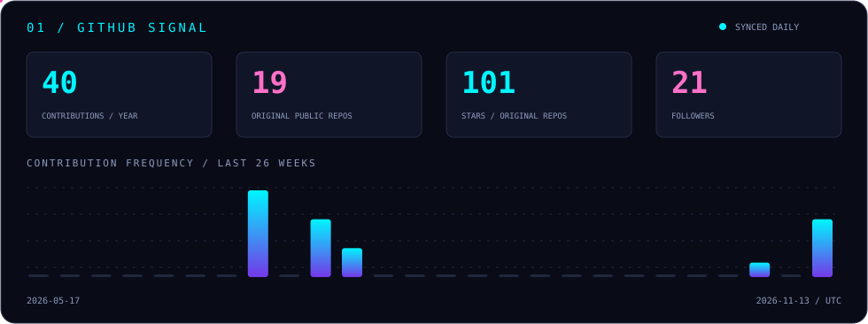
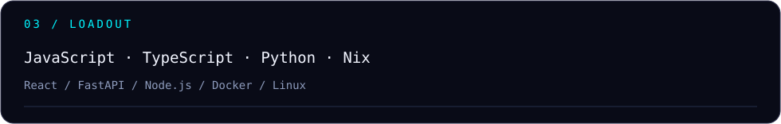

  
  

  <b>把想法写成代码，把重复交给自动化。</b> 
  <a href="https://github.com/tt619252615?tab=repositories">探索仓库 ↗</a>
  &nbsp; / &nbsp;
  <a href="https://github.com/tt619252615?tab=stars">我的收藏 ↗</a>

  

  

  
  
  
  
  

  
  

<!-- Contribution animation: https://github.com/Platane/snk / MIT license. -->
