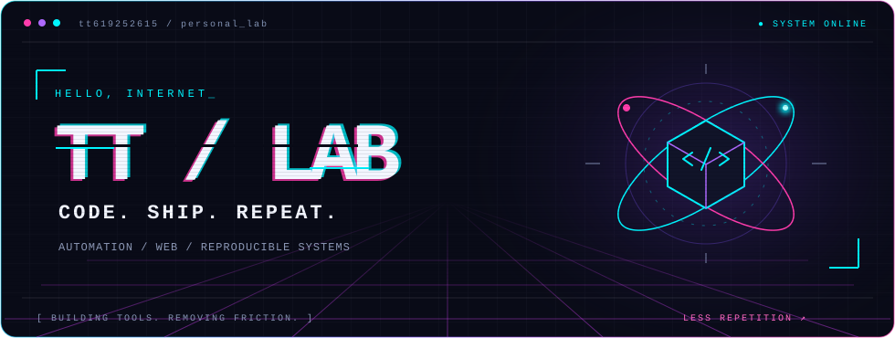
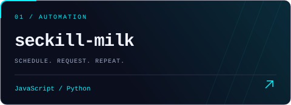
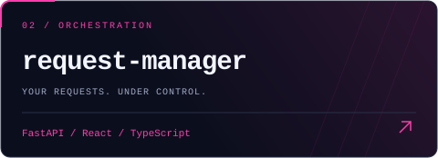
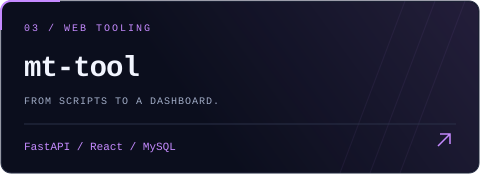

<p align="center">
  
</p>

<p align="center">
  <b>把想法写成代码，把重复交给自动化。</b><br />
  JavaScript / Python 工具开发 · Web 应用 · Nix 开发环境
</p>

<p align="center">
  <a href="https://github.com/tt619252615?tab=repositories">探索仓库 ↗</a>
  &nbsp; / &nbsp;
  <a href="https://github.com/tt619252615?tab=stars">我的收藏 ↗</a>
</p>

### `01 / SELECTED WORK`

<table>
  <tr>
    <td width="50%"><a href="https://github.com/tt619252615/seckill-milk"></a><br />小程序活动脚本，支持定时请求与任务配置。</td>
    <td width="50%"><a href="https://github.com/tt619252615/request-manager"></a><br />导入请求、编排任务、追踪执行结果。</td>
  </tr>
  <tr>
    <td width="50%"><a href="https://github.com/tt619252615/mt-tool"></a><br />用 FastAPI 与 React 管理活动请求和任务。</td>
    <td width="50%"><a href="https://github.com/tt619252615/nix-pkgs"></a><br />可复用的软件包与多语言开发环境模板。</td>
  </tr>
</table>

### `02 / TOOLBOX`

```text
  LANGUAGES     JavaScript · TypeScript · Python
  WEB           React · FastAPI · Node.js
  ENVIRONMENT   Nix · Docker · Linux
  EXPLORING     自动化工具 / 请求调度 / 数据分析
```

<p align="center">
  
</p>
